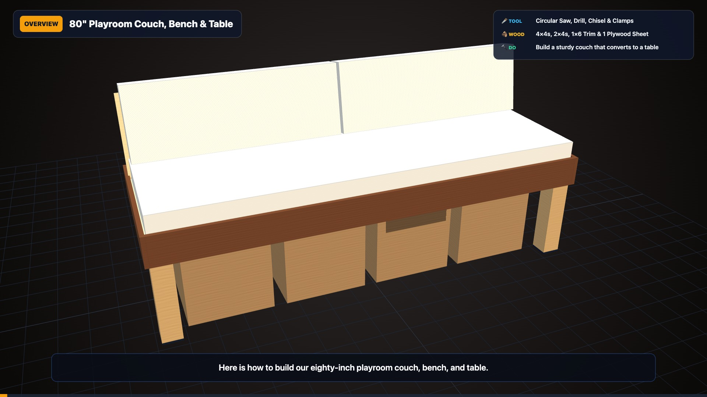
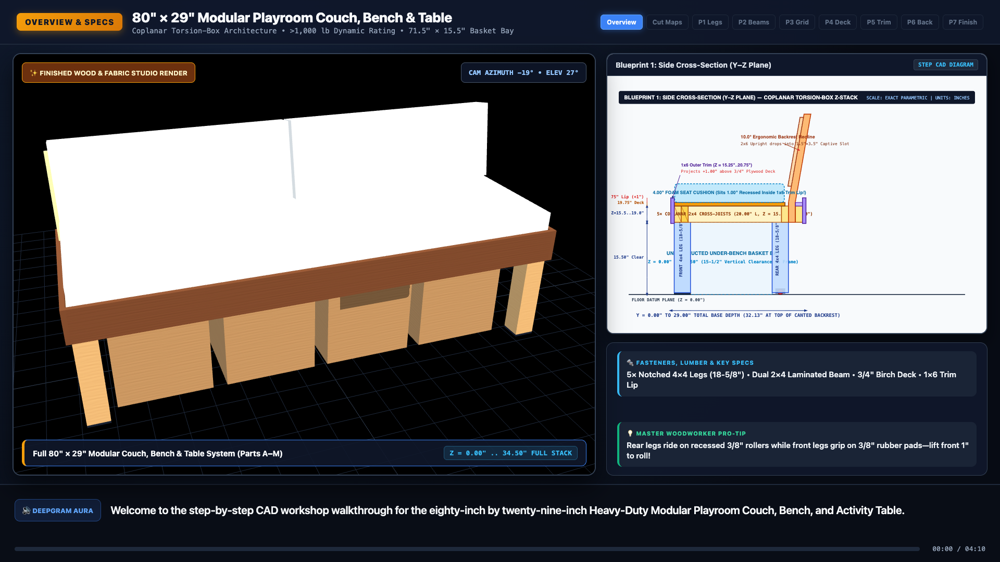
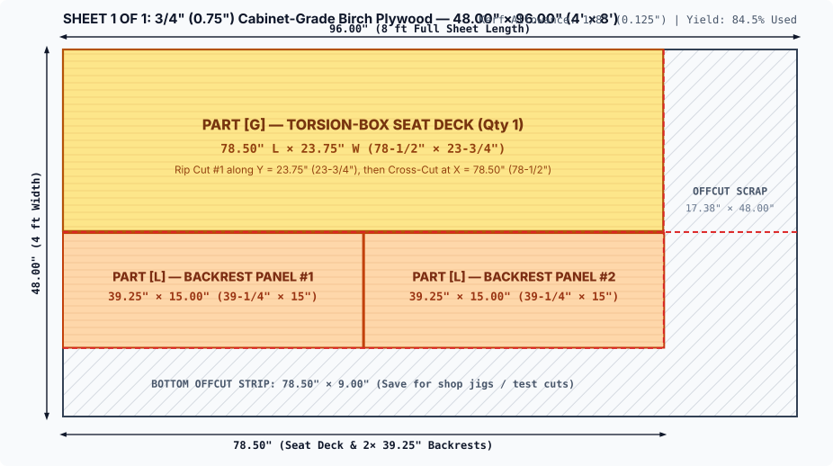
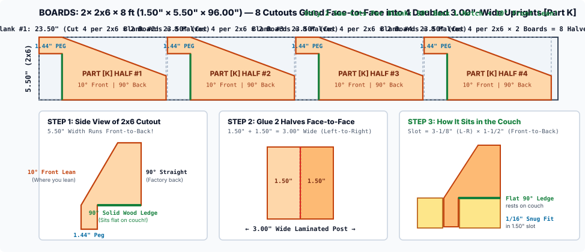
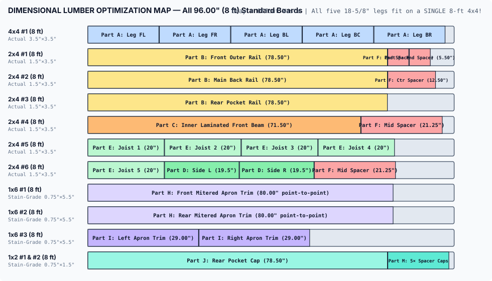
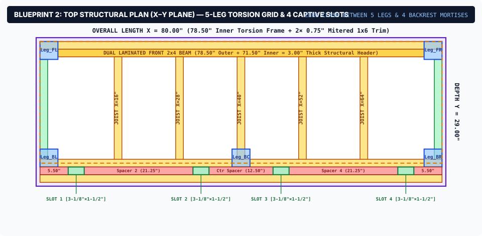
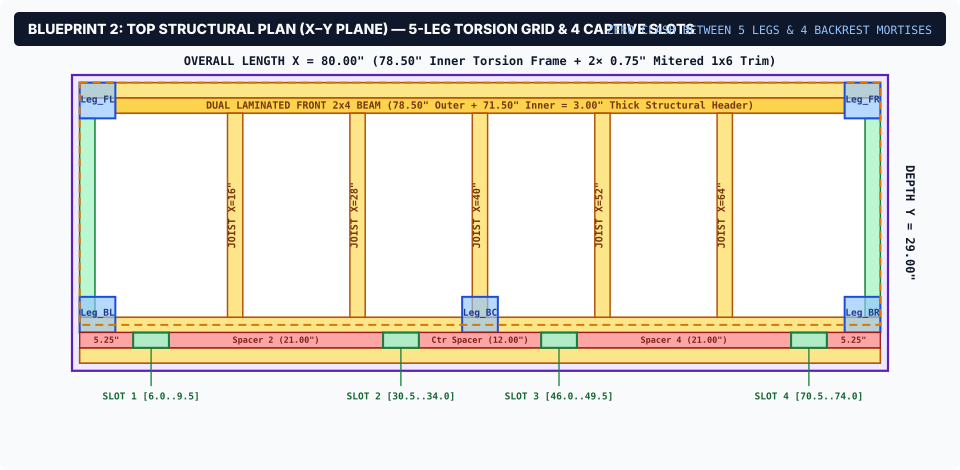
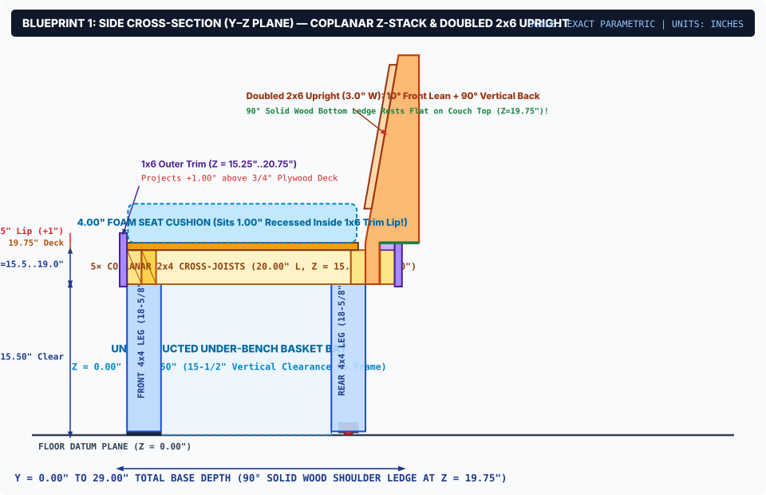
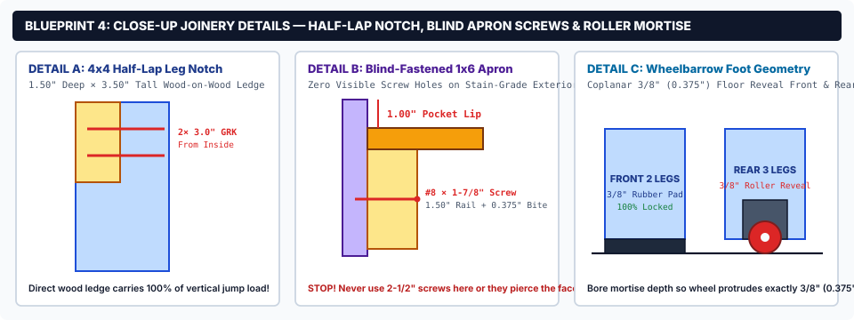
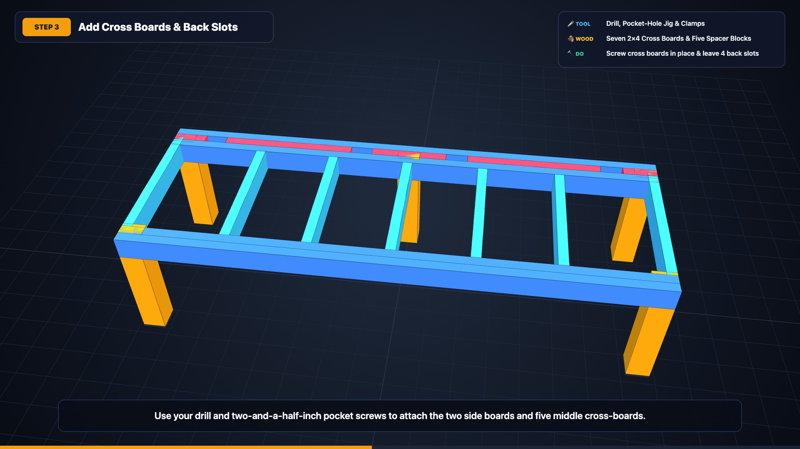

# 🛋️ 80" × 29" Heavy-Duty Modular Playroom Couch, Bench & Table

[](https://armacintosh.github.io/bench-build/)
[](https://youtu.be/tZgbSqcj_mg)
[](https://youtu.be/bgo88c1nscw)

An overbuilt, kid-jump-proof **80.00" Long × 29.00" Deep** modular playroom and basement rec-room furniture build that converts in 10 seconds between:
1. **A Deep Lounging Sofa** (with two independent, 10° reclined drop-in backrests)
2. **A 1,000+ lb Capacity Jump-Proof Bench**
3. **A Flat Play / Coffee Table** (when the backrest modules and cushion are lifted off)

All while maintaining an unobstructed **71.50" W × 15.50" H** front under-bench storage bay for 5 large soft storage baskets—with **zero center front post** in the way.



---

## 🚀 Grounded Scientific GitHub Pages Website & 3D CAD Studio

> **💡 Viewing on GitHub?** GitHub's code viewer displays raw HTML source code for `.html` files. Open the **Grounded Scientific Interactive Website** on GitHub Pages for the full multi-page experience (with light/dark mode, Three.js 3D CAD Studio, hover part inspector, and synchronized video chapters):
>
> ### 👉 **[Launch Grounded Scientific Build Website (`armacintosh.github.io/bench-build`)](https://armacintosh.github.io/bench-build/)**
>
> | Website Page | Direct URL | Contents |
> | :--- | :--- | :--- |
> | **01 // Studio & 3D CAD** | [`/bench-build/`](https://armacintosh.github.io/bench-build/) | Interactive Three.js 3D CAD Studio, 3D Phase Stepper, 1080p Video Player & Z-Stack Spec |
> | **02 // Materials & Cuts** | [`/bench-build/materials.html`](https://armacintosh.github.io/bench-build/materials.html) | Interactive Tool Checklist (`localStorage`), Master Shopping List (BOM) & SVG Cut Maps |
> | **03 // Blueprints & Audit** | [`/bench-build/blueprints.html`](https://armacintosh.github.io/bench-build/blueprints.html) | 4 High-Res Orthographic Architectural Blueprints & Structural Engineering Audit |
> | **04 // 7-Phase Roadmap** | [`/bench-build/roadmap.html`](https://armacintosh.github.io/bench-build/roadmap.html) | Sequential 7-Phase Assembly Timeline (`Why` / `Fasteners` / `Pro-Tip` + `▶ View in 3D CAD`) |
> | **Full Manual (All-in-One)** | [`/bench-build/modular_couch_build_guide.html`](https://armacintosh.github.io/bench-build/modular_couch_build_guide.html) | Complete 8-section engineering & assembly manual on a single printable page |

### 🎬 Narrated 1080p Video Walkthroughs

| Edition | Focus & Style | Duration | Watch Links |
| :--- | :--- | :---: | :--- |
| **🌱 Beginner 3D DIY Guide** | **Zero technical jargon.** Full-screen 3D CAD animations stating only the **Tool**, **Wood**, and **Action** for each step. | `3:33` | [**▶️ Watch on YouTube**](https://youtu.be/tZgbSqcj_mg) · [📥 Download MP4](videos/modular_couch_beginner_video.mp4) |
| **📐 Detailed CAD & Blueprint Guide** | **Complete engineering walkthrough.** Split-screen 3D CAD + orthographic SVG blueprints, fastener HUD, and exact elevation specs. | `4:31` | [**▶️ Watch on YouTube**](https://youtu.be/bgo88c1nscw) · [📥 Download MP4](videos/modular_couch_instructional_video.mp4) |



---

## ✨ Three Signature Design Features

1. **Sunken 1.00" Recessed Cushion Pocket (`Z = 19.75"` to `20.75"`)**
   A `3/4"` Birch Plywood seat deck (`78.50" × 27.50"`) sits atop a coplanar `2x4` torsion-box grid (`Z = 19.00"..19.75"`), surrounded by a mitered `1x6` stain-grade outer apron rising to `Z = 20.75"`. That creates a **1.00" perimeter lip** that locks a standard `78" × 24" × 4"` foam bench cushion in place without Velcro.
2. **"Wheelbarrow" Hidden Mobility (`3/8"` Ground Clearance)**
   The **2 front corner legs** rest on high-friction `3/8"` solid rubber pads (100% locked when kids jump or climb). The **3 rear legs** house recessed fixed-axle rubber rollers inside a `4.00" × 1.50"` bottom notch so the wheels protrude just `3/8"`. Lift the front apron by 1 inch to roll the entire couch effortlessly across the room.
3. **Drop-In 10° Slanted Backrests (2 Independent 40" Modules with Doubled 2x6 Uprights)**
   Each backrest uses **doubled `2x6` uprights (`3.00"` wide Left-to-Right × `5.50"` Front-to-Back)**. Each `2x6` has a `1-7/16"` (`1.44"`) bottom peg that drops into the `1.50"` front-to-back slot (`1/16"` snug slip-fit), a **`90°` solid wood rear shoulder ledge** that rests flat on top of the couch (`Z = 19.75"`), a `90°` vertical back edge, and a **`10.0°` front lean** where people lean back.

---

## 📏 Canonical Coplanar Z-Stack & Specification Summary

| Parameter / Elevation Layer | Z-Elevation Range | Exact Dimension | Engineering & Functional Role |
| :--- | :--- | :--- | :--- |
| **Overall Base Footprint** | `X: 0..80"` \| `Y: 0..29"` | `80.00" L × 29.00" D` | Fits standard `78" × 23.5"` cushion inside mitered `1x6` apron; `30.75"` depth at rear of `2x6` shoulder ledge. |
| **Feet: Pads (Front) & Rollers (Rear)** | `Z = 0.000"` to `0.375"` | `0.375"` (`3/8"`) | Front rubber grip pads + rear recessed fixed-axle wheels in `4.0" × 1.5"` notches. |
| **5× `4x4` Posts (`Part A`)** | `Z = 0.375"` to `19.000"` | `18.625"` (`18-5/8"`) | 4 corner posts + 1 rear-center post (`X = 38.25"..41.75"`). **Zero front-center post.** |
| **Clear Under-Bench Basket Bay** | `Z = 0.000"` to `15.500"` | `71.50" W × 15.50" H × 24.00" D` | Unobstructed front bay fits 4–5 large soft storage baskets side-by-side. |
| **Coplanar `2x4` Frame & Joists** | `Z = 15.500"` to `19.000"` | `3.500"` tall (`2x4` on edge) | Doubled front beam (`71.5"` + `78.5"`), rear rails (`78.5"`), 5 joists (`20.0"`), and 4 mortise slots (`3-1/8" L-R × 1-1/2" F-B`). |
| **`3/4"` Birch Plywood Seat Deck (`Part G`)** | `Z = 19.000"` to `19.750"` | `78.50" L × 23.75" D × 0.75"` | Glued and screwed across all `2x4` rails and joists + `1x2` rear slot caps (`Parts J & M`) flush at `Z = 19.75"`. |
| **Mitered `1x6` Stain-Grade Apron** | `Z = 15.250"` to `20.750"` | `5.500"` tall (`0.75"` thick) | Wraps the `78.5" × 27.5"` core to `80.0" × 29.0"` OD and forms the **1.00" cushion tray lip**. |
| **Doubled `2x6` Backrests (`Parts K & L`)** | `Z = 15.500"` to `39.000"` | `3.00" W × 5.50" F-B × 23.50" H` | `4.25"` bottom peg (`3.00" × 1.44"`) + **`90°` solid wood rear shoulder ledge** on `Z = 19.75"` + **`10.0°` front lean**. |

---

## 🛒 Master Lumber & Hardware Shopping List

### Lumber (Home Center / Lumberyard)
| Qty | Nominal Stock | Actual Cross-Section | Assigned Cut Pieces |
| :-: | :--- | :--- | :--- |
| **1** | `4x4 × 8 ft` Kiln-Dried Post | `3.50" × 3.50"` | Cuts all **5 legs** (`Part A` @ `18-5/8"` each) |
| **6** | `2x4 × 8 ft` Select Framing Studs | `1.50" × 3.50"` | Cuts front beams (`Parts B, C`), rear rails (`Part B`), side rails (`Part D`), 5 joists (`Part E`), and 5 slot spacers (`Part F`: `5.50", 21.25", 12.50", 21.25", 5.50"`) |
| **2** | `2x6 × 8 ft` Select Boards | `1.50" × 5.50"` | Cuts **8 upright halves (`23.50"` each)** → glued & screwed face-to-face in 4 pairs = **4 Doubled `3.00"`-wide Uprights (`Part K`)** |
| **3** | `1x6 × 8 ft` Select Pine / Oak | `0.75" × 5.50"` | Cuts outer mitered trim apron (`Parts H & I`: two `80.0"` rails + two `29.0"` sides) |
| **2** | `1x2 × 8 ft` Select Pine / Oak | `0.75" × 1.50"` | Cuts Rear Backer Cap (`Part J`, `78.50"`) + 5 Spacer Caps (`Part M`: `5.50", 21.25", 12.50", 21.25", 5.50"`) |
| **1** | `3/4" × 4' × 8'` Cabinet Birch Plywood | `0.75" × 48" × 96"` | Cuts the **`78.50" × 23.75"` seat deck (`Part G`)** AND both **`39.25" × 15.00"` backrest face panels (`Part L`)** |

### Hardware & Fasteners
- **1 box (50 ct):** `#10 × 3.00"` Structural Timber Screws (T-25 Star Drive)
- **1 box (50 ct):** `#10 × 2.75"` (`2-3/4"`) Heavy-Duty Lamination Screws (for front beam + laminating the 4 pairs of `2x6` uprights)
- **1 box (50 ct):** `2-1/2"` Heavy-Duty Pocket-Hole Screws
- **1 box (100 ct):** `#8 × 1-3/4"` Flat-Head Wood Screws (for Birch plywood seat deck & backrest panels)
- **1 box (50 ct):** `#8 × 1-7/8"` Pan/Flat Screws (driven from inside the `2x4` rails into the `1x6` outer apron)
- **3 sets:** Fixed-Axle Low-Profile Rollers (`3/8"` wheel reveal for the 3 rear legs)
- **2 pcs:** `3-1/2" × 3-1/2" × 3/8"` Heavy-Duty Solid Rubber Grip Pads (for the 2 front legs)
- **1 bottle (16 oz):** PVA Wood Glue (Titebond II or III) + Household Paraffin Wax

---

## 🪚 Cut Maps & Engineering Blueprints

All 14 scalable vector blueprints from the interactive guide are available as standalone SVGs in [`assets/blueprints/`](assets/blueprints/) and render directly below:

### Stock Cut Map 1 — `3/4"` Birch Plywood Sheet (`48" × 96"`)


### Stock Cut Map 2 — Doubled `2x6` Backrest Upright Nesting Map (`2 Boards` → `8 Halves` → `4 Posts` + 3-Step Visual Guide)


### Stock Cut Map 3 — Dimensional Lumber Optimization (`4x4` Post, `2x4` Studs, `1x6` Aprons & `1x2` Caps)


---

### Orthographic Blueprints (1–4)

#### Blueprint 1 — Top Plan View (`X-Y` Structural Layout & Four `3-1/8" × 1-1/2"` Mortise Slots)


#### Blueprint 2 — Front & Rear Elevations (`71.50" × 15.50"` Clear Basket Bay vs. 3-Leg Rear)


#### Blueprint 3 — Side Cross-Section (`Y-Z` Z-Stack, `90°` Solid Wood Rear Shoulder Ledge & `10°` Front Lean)


#### Blueprint 4 — Joinery Detail Cards (Half-Lap Ledge, Blind Apron Screws & Roller Mortise)


---

## 🔨 7-Step Assembly Overview



| Step | Phase Name | Key Action Summary | Diagram |
| :-: | :--- | :--- | :---: |
| **1** | **Prep the 5 `4x4` Legs** | Cut 5 posts (`Part A`) to `18-5/8"`. Mortise the 3 rear rollers (`3/8"` wheel reveal), attach the 2 front `3/8"` rubber grip pads, and gang-cut the `1.50" × 3.50"` top half-lap notches. | [View SVG](assets/blueprints/phase_01_legs_and_wheel_notches.svg) |
| **2** | **Laminated Front Beam & Portals** | Face-glue & screw the `71.50"` inner front beam (`Part C`) to the `78.50"` outer front rail (`Part B`), and lag the Front & Main Back Rails into the 5 notched `4x4` legs. | [View SVG](assets/blueprints/phase_02_outer_frame_and_sleeves.svg) |
| **3** | **Joist Grid & `3-1/8" × 1-1/2"` Slots** | Install the 2 side rails (`Part D`), 5 coplanar joists (`Part E`), and 5 spacer blocks (`Part F`: `5.50", 21.25", 12.50", 21.25", 5.50"`) + backer rail (`Part B`) to form four `3-1/8" × 1-1/2"` slots. | [View SVG](assets/blueprints/phase_03_interior_ribs_and_center_leg.svg) |
| **4** | **`3/4"` Birch Plywood Seat Deck** | Glue and screw the `78.50" × 23.75"` Birch plywood deck (`Part G`) atop the coplanar `2x4` grid using `#8 × 1-3/4"` screws every `8"`. | [View SVG](assets/blueprints/phase_04_plywood_seat_deck.svg) |
| **5** | **Blind-Screwed `1x6` Apron & `1x2` Caps** | Cap the rear slot spacers & backer rail with `1x2` strips (`Parts J & M`) flush at `Z = 19.75"`, and blind-screw the `45°`-mitered `1x6` aprons (`Parts H & I`) from inside. | [View SVG](assets/blueprints/phase_05_mitered_1x6_trim_apron.svg) |
| **6** | **Doubled `2x6` `10°` Drop-In Backrests** | Cut 8 halves from two `2x6` boards (**2 cuts per half**: `90°` back L-notch leaving a `1-7/16"` peg + `90°` solid wood shoulder ledge, and `10°` front lean). Glue in pairs (`3.00"` wide) and attach the two `39.25" × 15"` Birch panels (`Part L`). | [View SVG](assets/blueprints/phase_06_slanted_backrest_modules.svg) |
| **7** | **Sand, Finish, Wax & Cushions** | Sand `80 → 120 → 180` grit, apply water-based polyurethane, rub dry paraffin wax on the raw `4.25"` pegs, and drop in the `78" × 23.5" × 4"` foam seat cushion. | [View SVG](assets/blueprints/phase_07_finishing_pads_and_rollers.svg) |

---

## 📁 Repository Structure

```text
bench-build/
├── README.md                          # GitHub overview, specs, shopping list & embedded SVG blueprints
├── index.html                         # Live GitHub Pages Interactive 3D CAD & Video Build Guide
├── modular_couch_build_guide.html     # Direct permalink copy of the Interactive 3D CAD Build Guide
├── docs/
│   └── bench_spec.md                  # Canonical geometry, Z-stack math & structural engineering specification
├── videos/
│   ├── modular_couch_beginner_video.mp4       # Simplified 1080p Beginner 3D DIY Video (Tool • Wood • Action)
│   └── modular_couch_instructional_video.mp4  # Detailed 1080p 7-Phase CAD & Blueprint Walkthrough Video
├── assets/
│   ├── blueprints/                    # 14 standalone SVG cut maps, orthographic views & phase diagrams
│   └── images/                        # 1080p 3D CAD & photorealistic render preview images
└── scripts/
    ├── build_guide_generator.py       # Generates index.html & modular_couch_build_guide.html
    ├── generate_beginner_video.py     # Builds beginner TTS narration & stitches 1080p beginner MP4
    ├── render_beginner_video.mjs      # Headless Playwright + Three.js 3D frame renderer (Beginner video)
    ├── generate_tts_audio.py          # Builds detailed TTS narration via Deepgram Aura API
    ├── build_video_stage.py           # Builds 1920x1080 stage HTML for detailed walkthrough video
    ├── render_video_frames.mjs        # Headless Playwright + Three.js frame renderer (Detailed video)
    └── upload_to_youtube.py           # Uploads & updates videos on YouTube via OAuth 2.0 (.env credentials)
```

### Regenerating the HTML Guide Locally
```bash
python3 scripts/build_guide_generator.py
```
This updates both `index.html` and `modular_couch_build_guide.html` in the repository root with zero external runtime dependencies.
